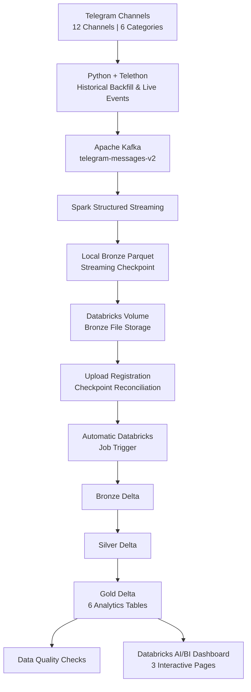
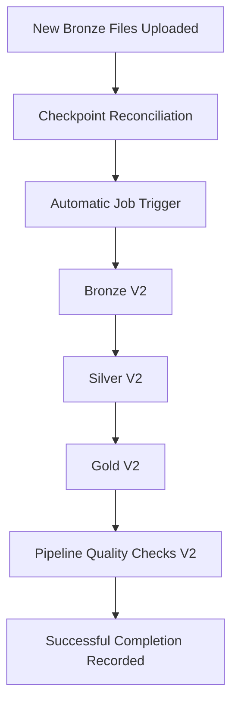
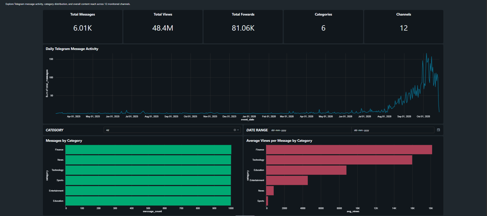
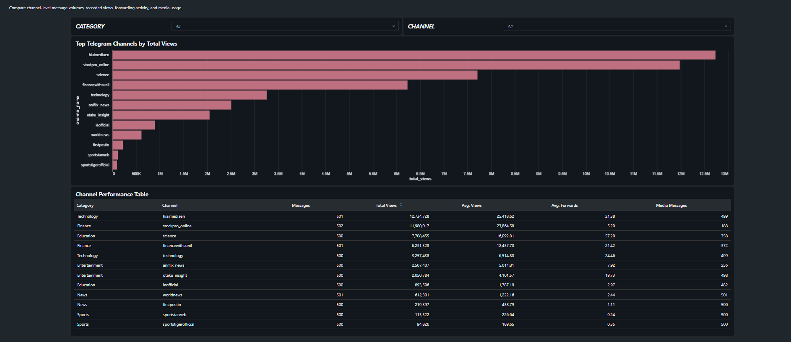
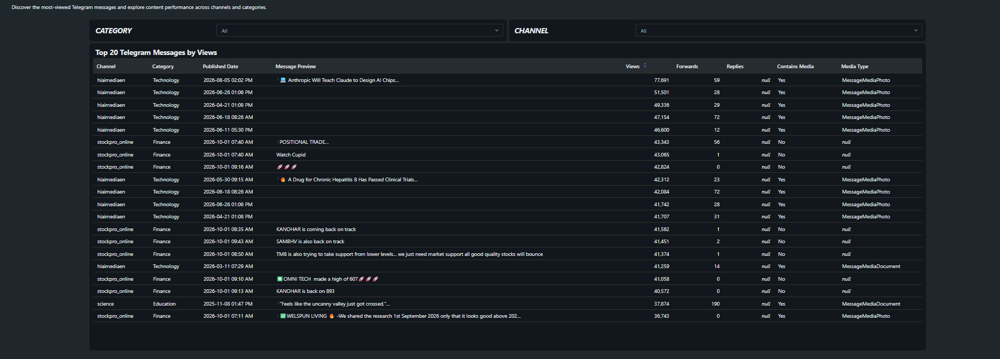

# Telegram Real-Time Data Platform

### End-to-End Data Engineering | Apache Kafka • Spark Structured Streaming • Databricks • Delta Lake

A data engineering platform that ingests historical and live Telegram messages, streams events through Apache Kafka, processes them using Apache Spark Structured Streaming, and transforms them into analytics-ready Delta Lake tables using Databricks.

The platform includes automated file synchronization, event-driven workflow triggering, checkpoint recovery, data quality validation, and an interactive analytics dashboard.

**Project Status:** Completed and validated end-to-end.

---

## 1. Project Overview

This project demonstrates the design and implementation of a data platform that combines real-time ingestion with reliable analytical processing.

The platform collects messages from **12 public Telegram channels across six categories**:

- Education
- Entertainment
- Finance
- News
- Sports
- Technology

It supports two ingestion modes:

**Historical Backfill:** Retrieves historical Telegram messages and publishes them to Kafka.

**Live Streaming:** Continuously listens for newly published Telegram messages and publishes them to Kafka.

Apache Spark consumes the Kafka events and stores them in local Bronze Parquet files.

A synchronization service uploads new files to a Databricks Unity Catalog Volume and automatically triggers a Databricks workflow.

The workflow processes the data through Bronze, Silver, and Gold Delta Lake layers, validates data quality, and makes the results available for analytics.

A three-page Databricks dashboard provides insights into message activity, channel performance, and Telegram content.

### Project Objectives

- Build an end-to-end data engineering platform.
- Implement historical and live data ingestion.
- Integrate Kafka with Spark Structured Streaming.
- Apply Medallion Architecture using Delta Lake.
- Automate Databricks workflow execution.
- Implement reliable checkpoint and recovery mechanisms.
- Validate data quality across pipeline stages.
- Deliver analytics-ready Gold tables.
- Build an interactive analytics dashboard.

---

## 2. System Architecture



### Architectural Approach

The platform uses a hybrid streaming and file-based processing architecture.

**Streaming Layer**

Telegram events are continuously published to Kafka and consumed by Spark Structured Streaming.

**Storage and Synchronization Layer**

Spark writes Bronze Parquet files locally. A synchronization service identifies eligible files and uploads them to Databricks.

**Analytical Processing Layer**

A Databricks workflow processes uploaded files through Bronze, Silver, and Gold Delta tables.

**Consumption Layer**

Gold tables power an interactive Databricks dashboard.

This architecture separates event ingestion from analytical transformations and allows each component to operate independently.

---

## 3. Technology Stack

| Technology | Purpose |
|---|---|
| Python 3.12 | Ingestion, orchestration, and automation |
| Telethon | Telegram API integration |
| Apache Kafka | Event streaming |
| Docker | Kafka containerization |
| Apache Spark 4.2.0 | Structured Streaming |
| PySpark | Distributed data processing |
| Apache Parquet | Local Bronze storage |
| Databricks | Cloud data processing |
| Delta Lake | Reliable analytical storage |
| Unity Catalog Volumes | Databricks file storage |
| Databricks Workflows | Automated pipeline execution |
| Databricks CLI | Workspace and job integration |
| Databricks AI/BI Dashboards | Analytics and visualization |
| Git and GitHub | Source control |
| Ubuntu / WSL | Local development environment |

---

## 4. Data Sources

### Telegram Channels

The platform monitors 12 Telegram channels across six categories.

Each category contains two configured channels.

Channel configuration is maintained in:

`config/telegram_channels.json`

### Historical Data

The historical ingestion phase collected:

| Metric | Value |
|---|---:|
| Telegram Channels | 12 |
| Categories | 6 |
| Historical Messages | 6,000 |
| Messages per Channel | 500 |
| Messages per Category | 1,000 |

The historical dataset was validated before enabling live streaming.

### Live Data

The live ingestion service uses Telethon's event listener to capture newly published Telegram messages.

A successfully captured live event was published to Kafka at offset `6000`, following the initial historical dataset.

Additional live events were subsequently processed through the pipeline.

---

## 5. End-to-End Data Pipeline

### Stage 1 — Telegram Ingestion

Two Python ingestion components support historical and live processing.

**Historical Ingestion**

`ingestion/src/telegram_history_to_kafka_v2.py`

**Live Ingestion**

`ingestion/src/telegram_live_to_kafka_v2.py`

The live ingestion service:

1. Connects to Telegram using Telethon.
2. Resolves configured Telegram channels.
3. Listens for newly published messages.
4. Constructs structured event records.
5. Publishes events to Kafka.

### Stage 2 — Apache Kafka

Kafka acts as the event-streaming layer.

**Kafka Bootstrap Server**

`localhost:9092`

**Kafka Topic**

`telegram-messages-v2`

Kafka decouples Telegram event collection from downstream processing.

This enables Spark to consume events independently of the Telegram ingestion service.

### Stage 3 — Spark Structured Streaming

**Script**

`spark/bronze/kafka_to_bronze_v2.py`

Spark continuously consumes Kafka messages and writes them as Parquet files.

The streaming layer preserves Kafka metadata and uses checkpointing to track processing progress.

**Local Bronze Storage**

`data/bronze/kafka_messages_v2/`

**Streaming Checkpoint**

`data/checkpoints/kafka_bronze_v2/`

The checkpoint allows Spark to resume processing from its recorded progress after a restart.

### Stage 4 — Databricks Volume Synchronization

**Script**

`ingestion/sync/bronze_to_databricks_v2.py`

The synchronization service:

1. Monitors local Bronze Parquet files.
2. Identifies files that have not been uploaded.
3. Checks the minimum file age.
4. Uploads eligible files to Databricks.
5. Updates upload checkpoints.
6. Reconciles uploaded and registered files.
7. Invokes automatic workflow triggering.

**Configuration**

| Setting | Value |
|---|---|
| Sync Interval | 60 seconds |
| Minimum File Age | 60 seconds |
| Databricks CLI Profile | `TELEGRAM_PROJECT` |
| Destination | `dbfs:/Volumes/workspace/default/telegram_raw_v2/bronze_kafka` |

### Stage 5 — Databricks Medallion Architecture

The platform implements Bronze, Silver, and Gold analytical layers.

#### Bronze Layer

The Bronze layer ingests uploaded raw events into Delta Lake.

Notebook:

`databricks/notebooks/v2/01_telegram_bronze_v2.py`

#### Silver Layer

The Silver layer transforms and prepares structured Telegram data for analytical processing.

Notebook:

`databricks/notebooks/v2/02_telegram_silver_v2.py`

#### Gold Layer

The Gold layer generates analytics-ready datasets.

Notebook:

`databricks/notebooks/v2/03_telegram_gold_v2.py`

#### Data Quality Layer

The final workflow task validates the analytical outputs.

Notebook:

`databricks/notebooks/v2/04_pipeline_quality_checks_v2.py`

An additional Bronze verification notebook is available:

`databricks/notebooks/v2/00_verify_bronze_v2.py`

---

## 6. Gold Analytics Tables

The pipeline produces six Gold V2 tables.

| Gold Table | Analytical Purpose |
|---|---|
| `telegram_category_summary_v2` | Category-level message and interaction summaries |
| `telegram_category_daily_metrics_v2` | Daily activity by category |
| `telegram_category_channel_rankings_v2` | Channel rankings within categories |
| `telegram_daily_metrics_v2` | Daily Telegram activity |
| `telegram_top_messages_v2` | Top-performing messages |
| `telegram_channels_v2` | Channel-level analytics |

These tables provide the analytical foundation for the dashboard.

### Available Analytics

- Message counts
- Category distribution
- Daily message activity
- Total recorded views
- Average views per message
- Forward counts
- Reply metrics where available
- Media message counts
- Channel rankings
- Top messages by recorded views

Recorded views are Telegram platform metrics and should not be interpreted as verified unique viewers.

---

## 7. Automated Databricks Workflow

The platform automatically triggers Databricks processing when newly uploaded files require processing.

**Job Name**

`telegram_medallion_pipeline_v2`

**Job ID**

`921048933612524`

### Workflow Execution



The synchronization service initiates processing without requiring manual execution of each notebook.

The workflow processes newly registered files and records the outcome in its trigger checkpoint.

### Verified Successful Execution

A live-processing workflow completed successfully.

**Verified Run ID:** `29559986940980`

| Workflow Task | Result |
|---|---|
| Bronze V2 | SUCCESS |
| Silver V2 | SUCCESS |
| Gold V2 | SUCCESS |
| Pipeline Quality Checks V2 | SUCCESS |

All four workflow tasks completed successfully.

---

## 8. Reliability Engineering

Reliability is a key feature of the V2 implementation.

### 8.1 Checkpoint Persistence

The platform maintains local checkpoint files for:

- Uploaded files
- Registered uploads
- Pending processing
- Inflight processing
- Completed processing
- Active Databricks runs
- Last successful workflow execution

### 8.2 Atomic Checkpoint Updates

Checkpoint state is persisted using atomic file-update techniques.

This reduces the risk of partially written checkpoint files.

### 8.3 Concurrency Control

The project uses file locking to coordinate access to shared checkpoint state.

**Implementation**

`ingestion/sync/checkpoint_lock_v2.py`

This helps prevent concurrent processes from overwriting one another's checkpoint updates.

### 8.4 Idempotent Job Submission

The workflow trigger maintains a durable submission token.

This supports recovery when an interruption occurs after submission begins but before the remote run ID is persisted.

### 8.5 Upload Reconciliation

The uploader compares uploaded files against registration records.

This helps identify files requiring registration or downstream processing.

### 8.6 Active Run Tracking

The trigger service checks Databricks job status before initiating additional processing.

It records active run IDs and updates state after job completion.

### 8.7 Failure Handling

When a workflow fails, the trigger service can pause retries.

This prevents repeated automatic submissions while an unresolved failure requires investigation.

### 8.8 Reliability Testing

The repository includes reliability tests covering:

- Checkpoint recovery
- Upload synchronization
- Trigger hardening
- Uploader integration
- Interrupted submission recovery
- Concurrent checkpoint access

Relevant tests include:

`experiments/reliability/test_trigger_hardening_v2.py`

`experiments/reliability/test_uploader_integration_v2.py`

The mocked trigger and uploader integration tests passed during project validation.

---

## 9. Validation Results

### 9.1 Historical Bronze Validation

| Validation | Result |
|---|---|
| Total Historical Records | 6,000 |
| Unique Event IDs | 6,000 |
| Unique Kafka Positions | 6,000 |
| Categories | 6 |
| Channels | 12 |
| Messages per Channel | 500 |
| Messages per Category | 1,000 |

### 9.2 Live Kafka Validation

A live Telegram event was successfully published to:

`telegram-messages-v2`

The event appeared at Kafka offset `6000`, confirming that live ingestion continued after the historical dataset.

### 9.3 Databricks Workflow Validation

A Databricks V2 workflow run completed successfully across Bronze, Silver, Gold, and quality-check tasks.

### 9.4 Trigger Checkpoint Validation

The final observed checkpoint state was:

```text
Pending: 0
Inflight: 0
Completed: 4
Active run: None
Last successful run: 29559986940980
Retry paused: False
```

This confirms that the observed processing cycle completed without remaining pending or inflight files.

### 9.5 Notebook Validation

All five exported Databricks V2 notebooks passed Python syntax validation.

| Notebook | Result |
|---|---|
| `00_verify_bronze_v2.py` | PASS |
| `01_telegram_bronze_v2.py` | PASS |
| `02_telegram_silver_v2.py` | PASS |
| `03_telegram_gold_v2.py` | PASS |
| `04_pipeline_quality_checks_v2.py` | PASS |

---

## 10. Telegram Analytics Dashboard

The project includes an interactive Databricks dashboard built from the Gold V2 analytics tables.

**Dashboard Name:** Telegram Channel Analytics V2

The dashboard contains three pages:

1. Overview
2. Channel Performance
3. Content Analytics

### 10.1 Overview

The Overview page presents high-level Telegram analytics.

**Dashboard Metrics**

| KPI | Observed Value |
|---|---:|
| Total Messages | Approximately 6.01K |
| Total Recorded Views | 48.4M |
| Total Forwards | 81.06K |
| Categories | 6 |
| Channels | 12 |

These values represent a dashboard snapshot and may change when additional events are processed.

**Visualizations**

- Total Messages KPI
- Total Views KPI
- Total Forwards KPI
- Categories KPI
- Channels KPI
- Daily Telegram Message Activity
- Messages by Category
- Average Views per Message by Category

**Interactive Filters**

- Category
- Date Range



### 10.2 Channel Performance

The Channel Performance page compares Telegram channels using recorded interaction metrics.

**Visualizations**

- Top Telegram Channels by Total Views
- Channel Performance Table

**Available Metrics**

- Category
- Channel
- Message Count
- Total Views
- Average Views
- Average Forwards
- Media Message Count

**Interactive Filters**

- Category
- Channel



### 10.3 Content Analytics

The Content Analytics page highlights the most-viewed Telegram messages in the selected dataset.

**Visualization**

Top 20 Telegram Messages by Views

**Displayed Information**

- Channel
- Category
- Published Date
- Message Preview
- Views
- Forwards
- Replies
- Media Availability
- Media Type

**Interactive Filters**

- Category
- Channel



### Dashboard Insights

The dashboard reveals several useful patterns within the collected dataset.

**Channel Comparison**

The `hiaimediaen`, `stockpro_online`, and `science` channels recorded some of the highest total view counts.

**Category Comparison**

Finance and Technology recorded substantially higher average views per message than several other categories.

**Historical Activity**

The collected dataset shows increasing message volume toward the most recent observation period.

Because historical ingestion uses a limited sample per channel, these patterns describe the collected records rather than complete Telegram publishing activity.

### Dashboard Access

The dashboard uses restricted Databricks sharing permissions.

Screenshots are included in the repository so the dashboard can be reviewed without requiring access to the Databricks workspace.

---

## 11. Repository Structure

```text
project3-telegram-realtime-data-platform/
│
├── config/
│   └── telegram_channels.json
│
├── ingestion/
│   ├── src/
│   │   ├── telegram_history_to_kafka_v2.py
│   │   └── telegram_live_to_kafka_v2.py
│   │
│   └── sync/
│       ├── bronze_to_databricks_v2.py
│       ├── databricks_job_trigger_v2.py
│       └── checkpoint_lock_v2.py
│
├── kafka/
│
├── spark/
│   ├── bronze/
│   │   ├── kafka_to_bronze_v2.py
│   │   └── verify_kafka_bronze_v2.py
│   │
│   ├── silver/
│   └── gold/
│
├── databricks/
│   ├── notebooks/
│   │   ├── 01_telegram_bronze.py
│   │   ├── 02_telegram_silver.py
│   │   ├── 03_telegram_gold.py
│   │   ├── 06_pipeline_quality_checks.py
│   │   │
│   │   └── v2/
│   │       ├── 00_verify_bronze_v2.py
│   │       ├── 01_telegram_bronze_v2.py
│   │       ├── 02_telegram_silver_v2.py
│   │       ├── 03_telegram_gold_v2.py
│   │       └── 04_pipeline_quality_checks_v2.py
│   │
│   ├── jobs/
│   └── sql/
│
├── experiments/
│   ├── channel_validation/
│   ├── kafka/
│   ├── reliability/
│   ├── spark/
│   └── telegram/
│
├── tests/
│
├── docs/
│   ├── architecture/
│   ├── decisions/
│   ├── data_dictionary.md
│   │
│   └── dashboard/
│       ├── overview.png
│       ├── channel_performance.png
│       └── content_analytics.png
│
├── data/                    # Ignored local data
├── .env.example
├── .gitignore
└── README.md
```

The repository preserves earlier V1 components alongside the final V2 implementation.

The V2 scripts and notebooks represent the validated architecture.

---

## 12. Environment Setup

### Prerequisites

- Python 3.12
- Docker
- Apache Kafka
- Apache Spark 4.2.0
- Databricks workspace
- Databricks CLI
- Telegram API credentials

### 12.1 Clone the Repository

```bash
git clone <repository-url>
cd project3-telegram-realtime-data-platform
```

Replace `<repository-url>` with the actual GitHub repository URL.

### 12.2 Create a Virtual Environment

```bash
python3 -m venv .venv
source .venv/bin/activate
```

Install the required Python packages for Telegram ingestion, Kafka integration, and Spark processing.

### 12.3 Configure Telegram Credentials

Copy the example environment file:

```bash
cp .env.example .env
```

Configure:

```text
TELEGRAM_API_ID
TELEGRAM_API_HASH
TELEGRAM_SESSION_NAME
LOG_LEVEL
TELEGRAM_CHANNELS
```

Do not commit `.env` or Telegram session files.

### 12.4 Configure Kafka

Start the local Kafka service.

Ensure that the following topic exists:

`telegram-messages-v2`

The ingestion and Spark scripts use:

`localhost:9092`

### 12.5 Configure Databricks

Authenticate the Databricks CLI using a profile named:

`TELEGRAM_PROJECT`

Ensure that the target workspace has the required Unity Catalog Volume, Delta tables, notebooks, and workflow configuration.

The current implementation contains environment-specific paths and identifiers that must be updated when deploying to another Databricks workspace.

---

## 13. Running the Pipeline

The pipeline components run as separate processes.

### Step 1 — Start Kafka

Start the Docker-based Kafka service.

Verify that Kafka is reachable on port `9092`.

### Step 2 — Start Live Telegram Ingestion

```bash
python -u ingestion/src/telegram_live_to_kafka_v2.py
```

The listener monitors configured Telegram channels and publishes new messages to Kafka.

### Step 3 — Start Spark Structured Streaming

```bash
spark-submit \
  --packages org.apache.spark:spark-sql-kafka-0-10_2.13:4.2.0 \
  spark/bronze/kafka_to_bronze_v2.py
```

The Spark Kafka connector must match the installed Spark and Scala versions and be available in the execution environment.

The streaming process consumes Kafka events and writes local Bronze Parquet files.

### Step 4 — Start Databricks Synchronization

```bash
python -u ingestion/sync/bronze_to_databricks_v2.py
```

The synchronization service:

- Detects new Bronze files.
- Uploads eligible files.
- Reconciles checkpoints.
- Registers new files.
- Automatically triggers Databricks processing.

### Step 5 — Monitor Databricks Workflow

The automated workflow executes:

```text
Bronze V2
   ↓
Silver V2
   ↓
Gold V2
   ↓
Pipeline Quality Checks V2
```

### Step 6 — View Analytics

Open the published Telegram Channel Analytics V2 dashboard in the authorized Databricks workspace.

The dashboard queries Gold analytical tables.

---

## 14. Data Quality and Testing

The project includes validation at multiple stages.

### Ingestion Validation

- Required event fields
- Event identifier uniqueness
- Timestamp validation
- Channel validation

### Kafka and Bronze Validation

- Kafka event ingestion
- Unique event identifiers
- Unique Kafka positions
- Category distribution
- Channel distribution

### Databricks Validation

- Bronze output availability
- Silver transformation execution
- Gold table generation
- Pipeline quality checks

### Reliability Validation

- Upload checkpoint recovery
- Registration reconciliation
- Trigger state management
- Idempotent submission
- Concurrent access protection
- Interrupted operation recovery

---

## 15. Engineering Challenges and Solutions

### Challenge 1 — Integrating Kafka with Spark

**Problem:** Spark requires an external Kafka connector to read Kafka topics.

**Solution:** Configure Spark with a compatible Kafka connector package.

**Learning:** Distributed processing frameworks often require connector dependencies that match the runtime environment.

### Challenge 2 — Combining Streaming and Batch Processing

**Problem:** Telegram and Kafka operate continuously, while Databricks analytical processing is initiated when new files are available.

**Solution:** Implement a file synchronization service that bridges continuous streaming and downstream analytical workflows.

**Learning:** Real-time ingestion does not require every downstream analytical transformation to execute for every event.

### Challenge 3 — Preventing Duplicate Job Submissions

**Problem:** An interrupted workflow submission can leave uncertainty about whether Databricks accepted the request.

**Solution:** Persist a submission token and reconcile the remote job state before retrying.

**Learning:** Reliable orchestration requires idempotency and recovery mechanisms.

### Challenge 4 — Maintaining Checkpoint Consistency

**Problem:** Multiple processes accessing checkpoint files can cause inconsistent state.

**Solution:** Use file locking and atomic checkpoint persistence.

**Learning:** Shared orchestration state requires concurrency control.

### Challenge 5 — Handling Pipeline Failures

**Problem:** Repeatedly retrying a failed workflow can create unnecessary processing and complicate recovery.

**Solution:** Introduce a retry-paused state and explicit failure handling.

**Learning:** Production-oriented pipelines require controlled recovery rather than unrestricted retries.

### Challenge 6 — Making Data Useful for Analytics

**Problem:** Processed Gold tables are not immediately accessible to nontechnical users.

**Solution:** Build a three-page Databricks analytics dashboard with KPIs, visualizations, and interactive filters.

**Learning:** Data engineering creates value when reliable data products can be consumed for analysis and decision-making.

---

## 16. Key Data Engineering Concepts

This project demonstrates:

- Event-driven architecture
- Historical data backfill
- Live event ingestion
- Kafka producers and consumers
- Spark Structured Streaming
- Streaming checkpoints
- Parquet storage
- Delta Lake
- Medallion Architecture
- Automated Databricks workflows
- Idempotent processing
- Checkpoint reconciliation
- Concurrency control
- Failure recovery
- Data quality validation
- Gold-layer analytics
- Interactive dashboards
- End-to-end pipeline validation

---

## 17. Future Improvements

Potential enhancements include:

1. Containerizing additional pipeline components.
2. Implementing CI/CD workflows.
3. Adding centralized monitoring and alerting.
4. Introducing automated deployment configuration.
5. Adding performance and scalability benchmarks.
6. Improving dashboard refresh automation.
7. Supporting additional Telegram channels and data sources.
8. Implementing more comprehensive end-to-end integration tests.

---

## 18. Project Outcome

The Telegram Real-Time Data Platform demonstrates an end-to-end data engineering solution that combines historical and live ingestion, Kafka streaming, Spark processing, Databricks Medallion Architecture, workflow automation, and analytical visualization.

### Verified Achievements

- **12 Telegram channels** across six categories.
- **6,000 validated historical messages.**
- Successful live Telegram-to-Kafka ingestion.
- Spark Structured Streaming with checkpointed Bronze storage.
- Automated Databricks Volume synchronization.
- Successful automatic Databricks workflow execution.
- Bronze, Silver, and Gold Delta Lake processing.
- Six Gold V2 analytics tables.
- Data quality validation.
- Reliability and recovery testing.
- Three-page interactive Databricks dashboard.

The project demonstrates both data pipeline implementation and operational reliability, with a complete path from source events to analytical consumption.

---

**Project Type:** Data Engineering Portfolio Project
**Architecture:** Hybrid Streaming + Automated Analytical Processing
**Status:** End-to-End Pipeline and Analytics Dashboard Completed
